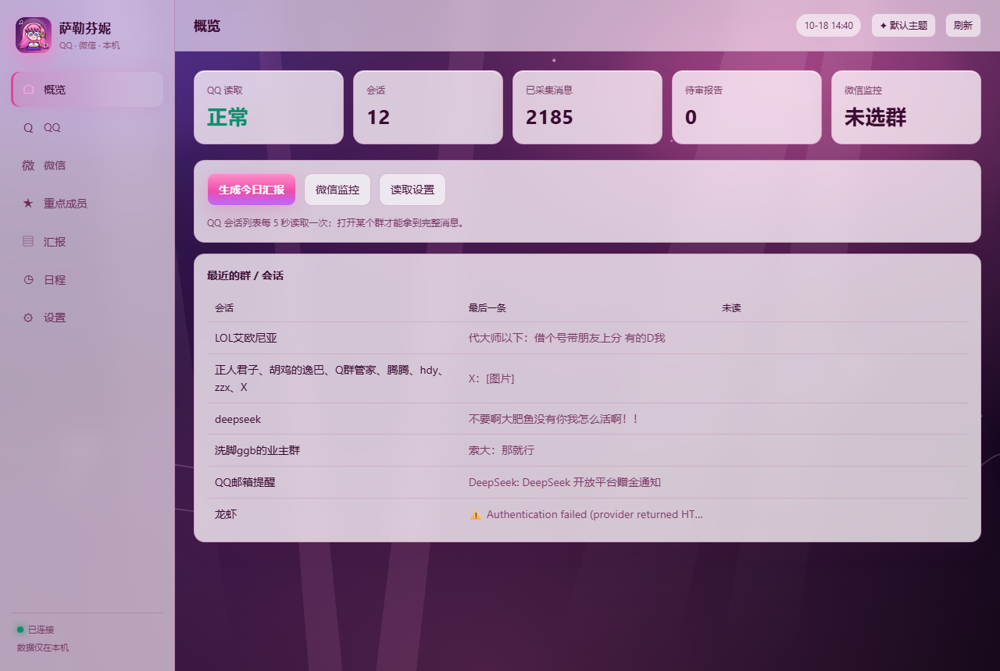

# 萨勒芬妮 · 本机群聊情报

把本机已登录的 QQ / 微信群聊，变成可检索、可汇报、可排日程的情报流：

> 读取会话 → 关注重点成员 → 生成待审报告 → 人工批准后外发；顺手把群里的时间信息变成日程。

默认是萨勒芬妮亮白粉玻璃主题：原创抽象舞台背景 + 半透明白玻璃 + 深紫文字；右上角可切回默认深色。



---

## 1. 能力清单

| 能力 | 说明 |
|---|---|
| 打开即用 | 双击桌面「萨勒芬妮」快捷方式：自动拉起 Hub、恢复 QQ 无障碍模式、打开独立应用窗口 |
| QQ 读取 | UI Automation：会话列表、最后一条、未读、当前会话全文；不装插件、不读数据库 |
| 微信读取 | 后台 `PrintWindow` 截图 + `PostMessage` 点击；支持最小化/托盘，逐条 OCR 入库 |
| 监控群 | 每个群独立开关、自动补全、本群关键词 |
| 重点成员 | 按群关注；跨群昵称搜索；优先级/备注 |
| 一键报告 | 默认从上次报告结束时间补采微信，最多向上 8 页，逐条去重后生成待审报告 |
| 一键日程 | 从上次生成时间补采微信，提取日程并落库，可导出 ICS/CSV/Markdown |
| 审核门禁 | 报告只有人工批准后才外发；支持文件/DSH/QQ 私聊/微信通道 |
| 摘要 | 重点用户、关键消息、公告、提问、链接、自定义关注、群活跃度 |
| 自定义读取 | 全局关键词、单群关键词、关键词/正则规则、权重 |
| DSH 集成 | 20 个 MCP 工具 + 通知唤醒插件 |
| 后台 | 微信读取不抢焦点、不弹窗；最小化/托盘时屏幕外临时复活 |
| 自动清理 | 定时清理微信 OCR 截图与浏览器缓存，不动消息库、报告和登录态 |

---

## 2. 快速开始

1. 双击桌面 **「萨勒芬妮」**（或项目里的 `启动萨勒芬妮.vbs`）。
2. 启动器会：
   - 没有 Hub 就后台拉起；
   - 检查 QQ 是否以无障碍模式运行，不是就重启一次；
   - 用 Edge/Chrome `--app` 模式打开独立窗口。
3. QQ 停在登录界面时，登录后再双击一次。
4. 左侧页面：
   - **概览**：状态、会话数、消息数、待审报告；
   - **QQ**：会话列表、群设置、最近消息；
   - **微信**：监控群勾选、巡检间隔、最近收录；
   - **重点成员**：按群关注 + 跨群搜索；
   - **汇报**：生成、审核、批准、驳回；
   - **日程**：生成、查看、导出；
   - **设置**：QQ 巡检、关键词、自定义规则、摘要与投递。

> 正常点 QQ 图标启动会丢失无障碍模式；下次用启动器即可。

### 作为 DSH 插件安装（npm）

```powershell
# 1. 把 bundle 装进一个 DSH profile（首次会创建 MCP 配置）
npx -p @deepseek-ai/dsh dsh plugin --profile web add seraphine-group-digest@0.1.0

# 2. 重启 DSH 后，MCP 工具以 mcp__seraphine__* 出现
```

bundle 通过 `cordis.patch.yml` 注册 `@deepseek-ai/dsh-mcp-client`，不写死本机路径。首次启动 MCP 时若没有配置，会自动在 `%USERPROFILE%\.seraphine\config.json` 初始化一份；本机开发仍优先包根 `config.json`。

也可以单独运行 CLI：

```powershell
npx -y -p seraphine-group-digest@0.1.0 seraphine status
```

---


## 3. 微信后台巡检

### 3.1 开启

应用 → **微信**：

1. 点「刷新微信群列表」（后台截图/OCR，不抢焦点、不弹窗）；
2. 勾选要监控的群（支持全选/清空）；
3. 点「保存微信监控」。

默认每 120 秒巡检一次；保存后立即生效，不需要重启 Hub。

### 3.2 机制

- `PrintWindow(..., 2)` 后台截图；
- `PostMessage` 后台点击/滚轮；
- 不调用 `SetForegroundWindow`，不切前台；
- 微信最小化/收托盘时，在屏幕外临时恢复窗口，完成读取后恢复原状；
- 会话预览变化 → 打开群 → OCR 聊天区；
- 按发送者/正文/时间戳拆成逐条消息；
- 同一条消息按内容 + 群 ID 去重，重复巡检不会重复入库；
- 补采支持自适应翻页：内容重复或翻到更早时间就停止，最多 8 页。

### 3.3 边界

- 不是协议级全量：只覆盖当前可见一屏 + 向上 8 页；两次巡检之间超出屏幕的消息可能漏。
- OCR 可能认错生僻字、昵称、时间戳；发送者按布局启发式还原。
- 打开群会清除该群未读。
- 微信进程必须运行；彻底退出微信则停止。
- 图片/语音/文件只记占位符。

---

## 4. 一键报告 / 一键日程

### 4.1 报告

「汇报」页：

- 默认 **自上次报告结束时间** 起算；
- 也可选 6/12/24/72 小时；
- 点击后先补采已勾选微信群，再生成待审报告；
- 显示补采进度秒数；
- 生成后自动打开报告预览；
- 必须人工批准后才外发。

### 4.2 日程

「日程」页新增 **从群聊生成日程**：

- 默认自上次生成时间起算；
- 同样先补采微信，再提取日程；
- 可导出 ICS/CSV/Markdown；
- OCR 噪音（图片占位、聊天记录、错位符号）会被过滤，避免垃圾日程。

---

## 5. 重点成员

- **QQ 页 / 重点成员页**：选群 → 最近发言成员 → 关注；
- **跨群搜索**：输入昵称，查找该成员在哪些群出现过，直接关注；
- 支持优先级 `high / normal / low` 与备注；
- 关注用户的发言会进入报告的「重点用户动态」。

---

## 6. DSH 集成

MCP 工具（节选）：

| 工具 | 用途 |
|---|---|
| `group_status` | Hub/适配器状态 |
| `group_list` | 群列表 |
| `group_messages` | 检索消息 |
| `group_follow` / `group_follows` | 关注管理 |
| `group_qq_read` | 打开 QQ 群读最近消息（会清未读） |
| `group_wechat_preview` | 微信窗口 OCR 预览（仅调试，会前台显示） |
| `group_digest` | 生成摘要 |
| `group_report_create` / `group_reports` | 待审报告 |
| `group_report_approve` | 用户明确批准后外发（必须 `confirmed=true`） |
| `group_schedule` | 日程提取/导出 |

DSH 唤醒插件会把待审报告推进当前会话，但不会自动发送。

---

## 7. 配置

`config.json` 常用项：

| 配置 | 默认 | 说明 |
|---|---|---|
| `server.port` | `8791` | Hub 端口 |
| `adapters.qqUia.enabled` | `true` | QQ 界面读取 |
| `adapters.qqUia.intervalMs` | `5000` | QQ 轮询，最小 1500 |
| `adapters.wechatOcr.enabled` | `true` | 微信巡检总开关 |
| `adapters.wechatOcr.intervalMs` | `120000` | 微信巡检，最小 30000 |
| `watch.keywords` | 常见事项词 | 全局关键词 |
| `watch.customRules` | `[]` | 自定义关键词/正则规则 |
| `digest.lookbackHours` | `12` | 无历史报告时的默认回看 |
| `delivery.channels` | `["file"]` | 批准后的投递通道 |
| `review.required` | `true` | 强制人工审核 |

所有数据在本机：SQLite + `127.0.0.1` HTTP。

---

## 8. 测试

```powershell
node test/run.js
# 20 项全部通过
```

覆盖：时间/日程/存储/摘要/审核/投递/HTTP/调度/OneBot/UIA/微信 OCR/MCP。

---

## 9. 主题与版权

- 默认主题：萨勒芬妮粉紫舞台风（`app/seraphine-bg.jpg` + `app/icon.png`）。
- 右上角「✦ 默认主题」可切回深色；选择会记住。
- 背景为原创抽象舞台 SVG（`app/seraphine-bg.svg`），不含 Riot 原画或官方素材，可公开分发。
- Q 版图标为原创绘制，仅参考粉紫配色、麦克风与星星等通用元素，不使用官方 Logo/原画切片。
- 仓库公开时请勿重新加入 `Seraphine_0.jpg` 等官方原画。

---

## 10. 注意

- 报告外发必须人工批准，程序不会自行发送。
- 微信截图会短暂写入 `state/exports/wechat/`，适配器只保留最近 40 张 / 2 小时。
- 微信 OCR 是屏幕级读取，不是数据库/协议级全量；需要真正全量历史请使用 Webhook/桥接或独立设备方案。
